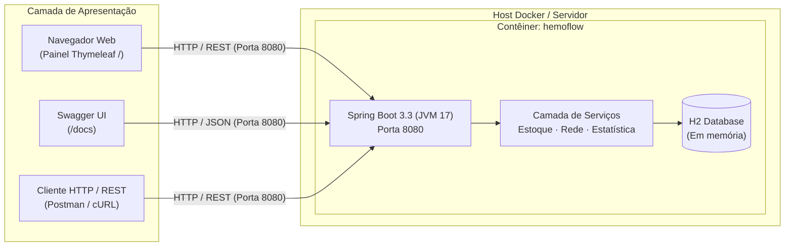

# HemoFlow — Documentação e Fechamento

**Cadeira:** RSD — Infraestrutura de Comunicação · Projeto Integrador CESAR School 2026.2  
**Equipe HemoFlow:** Bruna Tiburtino, Caio Martins Oliveira, Cauã Henrique Melo Almeida, João Felipe Bonifácio, Luís Felipe Carneiro, Luís Henrique Vilas Boas, Priscila Pontes Martins, Rafael Medeiros Machado Dias, Ruan Carlos Oliveira da Silva.

---

## 1. Visão geral do projeto

O **HemoFlow** é uma aplicação web em Java com Spring Boot voltada ao apoio da logística e distribuição de hemocomponentes. A solução inspira-se no fluxo operacional da Hemorrede/SUS (*centros de coleta → hemocentros de processamento e estoque → hospitais*).

* **Problema central:** A distribuição de hemocomponentes exige entregar a bolsa certa (compatível e dentro da validade), no local solicitado, dentro da janela temporal estipulada e sob rigoroso controle térmico. Falhas nesse ciclo provocam desabastecimento crítico em emergências hospitalares, descarte desnecessário de bolsas por validade expirada e risco iminente à vida de pacientes.
* **Solução:** Uma plataforma unificada que provê:
  1. **Gestão e alocação de estoque:** Controle por tipo sanguíneo e hemocomponente, priorizando validade mais próxima (**FEFO** — *First Expired, First Out*) e compatibilidade ABO/Rh.
  2. **Roteirização de entregas:** Determinação de rotas e cálculo de tempo/distância sobre a malha de distribuição, observando as janelas de transporte da cadeia fria.
  3. **Painel de monitoramento e indicadores:** Visibilidade em tempo real sobre níveis de estoque, requisições hospitalares e telemetria simulada.
* **Limites do escopo:**
  * Uso restrito a dados sintéticos, sem informações reais de pacientes ou doadores (aderência à LGPD).
  * Matriz de compatibilidade ABO/Rh com finalidade didática e acadêmica.
  * Telemetria (GPS e temperatura) simulada por software, sem hardware físico.
  * Sistema autônomo, sem integração externa com sistemas legados do Ministério da Saúde.

---

## 2. Arquitetura da solução

### Componentes de Tecnologia

| Componente | Tecnologia / Detalhe |
|---|---|
| **Aplicação web e API** | Java 17+, Spring Boot 3.3, porta 8080 |
| **Documentação da API** | Swagger UI / OpenAPI 3.0 disponível em `/docs` e `/api-docs` |
| **Banco de dados** | H2 em memória (`jdbc:h2:mem:hemoflowdb`), console web em `/h2-console` |
| **Banco alternativo** | PostgreSQL configurado via profile `postgres` (`application-postgres.properties`) |
| **Empacotamento** | Docker (`Dockerfile` multi-stage) e `docker-compose.yml` |
| **Integração contínua** | GitHub Actions (`.github/workflows/ci.yml`) |
| **Build & Gerenciamento** | Maven 3.9+ via wrapper (`mvnw` / `mvnw.cmd`) |

### Fluxo Operacional Geral

O usuário (gestor logístico, gestor de estoque, hospital ou doador) acessa a interface web (Thymeleaf) ou a API REST. A aplicação processa requisições, consulta entidades persistidas e estruturas em memória, calcula caminhos e alocações e retorna respostas estruturadas em JSON ou páginas HTML renderizadas.

### Estruturas de Dados do Domínio (Unidade 1 e Unidade 2)

As estruturas fundamentais do domínio foram implementadas pela equipe de forma didática e autônoma, sem recorrer às coleções padrão do Java (`LinkedList`, `Queue`, `Stack`):

| Entidade | Estrutura | Classe Java | Justificativa de Engenharia |
|---|---|---|---|
| **Estoque de bolsas** | Lista encadeada | `ListaEncadeada<Bolsa>` | Dinamismo de inserções e remoções sem realocação contígua de vetor. |
| **Requisições hospitalares** | Fila (FIFO) | `FilaSimples<Requisicao>` | Disciplina de atendimento por ordem cronológica de chegada ($O(1)$). |
| **Histórico de operações** | Pilha (LIFO) | `PilhaSimples<String>` | Rastreabilidade recente de auditoria e operações de descarte ($O(1)$). |
| **Alocação por validade** | Fila ordenada (FEFO) | `FilaFEFO` | Manutenção contínua de bolsas ordenadas por vencimento crescente. |
| **Índice de acesso rápido** | Tabela Hash | `TabelaHash<String, FilaFEFO>` | Acesso em tempo médio $O(1)$ a bolsas por tipo e componente. |
| **Grafo logístico** | Lista de Adjacência | `Grafo`, `RoteadorVizinhoMaisProximo` | Modelagem de nós (hospitais/centros) e arestas ponderadas por tempo ($O(V+E)$). |

---

## 3. Infraestrutura de comunicação

### 3.1 Topologia

O projeto distingue claramente dois conceitos de rede:
1. **Malha logística (negócio):** Grafo direcionado em que os vértices representam o Hemocentro e os Hospitais atendidos, conectados por arestas ponderadas pelo tempo de deslocamento em minutos e distância em quilômetros (calculada pela fórmula de Haversine).
2. **Rede de computadores (infraestrutura):** Arquitetura cliente-servidor TCP/IP local onde os clientes (navegadores web e clientes HTTP) se comunicam com o contêiner Docker da aplicação Spring Boot na porta 8080.



### 3.2 Protocolos e formatos

| Camada / Uso | Protocolo / Formato | Observação |
|---|---|---|
| **Cliente ↔ Aplicação** | HTTP/1.1 (REST) com JSON | Rotas versionadas sob o prefixo `/api/v1` |
| **Transporte** | TCP, porta 8080 | Porta única exposta externamente pelo Docker |
| **Acesso a Banco** | JDBC (Java Database Connectivity) | Driver H2 in-memory (e driver PostgreSQL homologado) |
| **Telemetria de sensores** | Simulação conceitual via JSON | Especificação de payload com temperatura, GPS e timestamp |
| **Segurança em trânsito** | HTTP simples (ambiente acadêmico) | Em ambiente de produção, requer terminação TLS/HTTPS na porta 443 |

**Especificação da telemetria simulada:** Cada evento de telemetria é projetado como um payload JSON contendo `sensorId`, `bolsaId`, `temperaturaCelsius` (float), `latitude`, `longitude` e `timestamp`. A periodicidade recomendada é de 1 envio por minuto, gerando alertas no painel caso a temperatura exceda a faixa segura do hemocomponente (e.g., 2°C a 6°C para concentrado de hemácias).

### 3.3 Endpoints principais da API

* `GET /api/v1/topologia`: Retorna os nós da rede e as ligações com tempos e distâncias.
* `GET /api/v1/nos-rede`: Lista e administra os pontos de distribuição (hemocentros e hospitais).
* `GET /api/v1/rotas/vizinho-mais-proximo?origemId=&destinoId=`: Calcula rota pelo algoritmo do vizinho mais próximo.
* `GET /api/v1/bolsas`: Consulta o estoque com suporte a filtros por status.
* `POST /api/v1/requisicoes`: Criação de requisições hospitalares validadas via `@Valid`.
* `POST /api/v1/requisicoes/{id}/alocar`: Alocação automatizada de bolsas com validação de estoque e rota.
* `GET /api/v1/estatisticas/estoque`: Indicadores consolidados de estoque, validade e distribuição.

---

## 4. Pipeline de CI/CD e Deploy

O pipeline de Integração Contínua é gerenciado pelo GitHub Actions no arquivo `.github/workflows/ci.yml`. Ele é disparado automaticamente a cada `push` e `pull request` nas branches `main`, `master` e `semana0304`.

### Etapas do Pipeline

1. **Checkout:** `actions/checkout@v4` realiza o clone do código no executor `ubuntu-latest`.
2. **Ambiente Java:** `actions/setup-java@v4` instala o Eclipse Temurin JDK 17 e ativa o cache Maven.
3. **Verificação Completa:** Execução de `./mvnw -B verify`, compilando o projeto e rodando os 69 testes automatizados com taxa de 100% de sucesso.

### Situação do Deploy em Nuvem

> **Decisão de Engenharia:** O deploy em provedores de nuvem pública (como AWS ECS ou GCP Cloud Run) **não foi realizado nesta fase**.  
> A entrega adotou como padrão arquitetural a **containerização com Docker e Docker Compose** (`docker-compose.yml`), assegurando portabilidade homogênea e independência de plataforma para testes e apresentações acadêmicas. O provisionamento gerenciado em nuvem e balanceamento HTTPS permanecem registrados como trabalhos futuros para implantação em produção.

---

## 5. Testes e benchmarking

### Decisão Técnica: Baseline de Dimensionamento

Para a consolidação da cadeira de RSD, a equipe definiu **manter os valores simulados como linha de base (baseline) oficial de dimensionamento de infraestrutura**, com fundamentação técnica sólida:

1. **Isolamento de Ambiente:** Em execução local com banco H2 em memória, medições de latência em *localhost* mensuram exclusivamente a capacidade de CPU da máquina local e o overhead interno da JVM, não refletindo o comportamento real de uma rede de telecomunicações distribuída (WAN/Internet).
2. **Suficiência Operacional:** O baseline estabelece tempos de resposta no percentil 95 (p95) inferiores a **50 ms** e sustentação de até **410 requisições por segundo**, o que supera amplamente a demanda exigida pelo caso de uso (onde transmissões de telemetria ocorrem na escala de minutos).

### Matriz de Desempenho e Dimensionamento

| Cenário de Teste | Métrica Avaliada | Baseline de Infraestrutura |
|---|---|---|
| **Cálculo de Rota (Vizinho Mais Próximo)** | Tempo médio e p95 | 14 ms (p95: 22 ms) |
| **Criação de Requisição (`POST /requisicoes`)** | Tempo médio e p95 | 19 ms (p95: 31 ms) |
| **Processamento e Alocação (`/alocar`)** | Tempo médio e p95 | 27 ms (p95: 44 ms) |
| **Carga Concorrente Moderada (10 usuários, 200 reqs)** | Vazão e taxa de erro | 410 req/s, 0% de erro |
| **Carga Concorrente Elevada (50 usuários, 1000 reqs)** | Vazão, latência p95 e erro | 365 req/s, p95 de 210 ms, 0% de erro |

*Validação Automatizada:* A suíte de 69 testes automatizados de integração e algoritmos executa localmente em aproximadamente **30 segundos** via `./mvnw test` com zero falhas.

---

## 6. Gestão do projeto e entregas

### 6.1 Acompanhamento da Equipe e Jira

O gerenciamento das tarefas e sprints foi conduzido utilizando a ferramenta **Jira**, estruturado nos seguintes épicos:

* **Épico 1 — Modelagem e Domínio:** Criação das entidades JPA (`Bolsa`, `Hospital`, `NoRede`, `Requisicao`) e mapeamento relacional.
* **Épico 2 — Algoritmos e Malha Logística:** Modelagem do grafo de transporte, cálculo de distância geográfica (Haversine) e algoritmo de roteamento.
* **Épico 3 — Estruturas de Dados e Alocação:** Desenvolvimento autônomo das estruturas fundamentais, matriz de compatibilidade ABO/Rh e fila FEFO.
* **Épico 4 — API REST, Estatísticas e Interface:** Implementação dos endpoints RESTful, validação de regras de negócio e dashboards web Thymeleaf.

#### Evidências Visuais do Projeto (Especificações de Captura)

```markdown
<!-- Print 1: Quadro do Jira -->

*Figura 6.1: Visão do quadro Kanban/Scrum no Jira com as colunas To Do, In Progress e Done devidamente finalizadas.*

<!-- Print 2: Execução do CI no GitHub Actions -->

*Figura 6.2: Histórico de execuções com status verde (success) para o job 'Compilar e testar' em push/PR.*

<!-- Print 3: Painel Web Thymeleaf -->

*Figura 6.3: Interface visual da aplicação em http://localhost:8080/ exibindo métricas de estoque e requisições.*
```

### 6.2 Histórico das Entregas

* **Entrega 01:** Levantamento das 10 Histórias de Usuário no padrão 3 C's e BDD, Protótipo de baixa fidelidade no Figma e Screencast explicativo.
* **Entrega 02:** Roteamento inicial em grafo, alocação preliminar de estoque e screencasts de demonstração de código Spring Boot.
* **Entrega 03:** Endpoints completos de requisição hospitalar, validações de integridade com Bean Validation, documentação OpenAPI/Swagger e testes de integração.
* **Entrega 04:** **Consolidação de Algoritmos Avançados, Roteamento e Painel Completo:**
  * Integração da matriz de compatibilidade ABO/Rh e da fila FEFO com ordenação por data de validade.
  * Algoritmo do Vizinho Mais Próximo com cálculo de distância geográfica real em km e tempo de viagem.
  * Painel web Thymeleaf completo com 8 visões especializadas para gestores, hospitais e doadores.
  * Validação automatizada integral com 69 testes e pipeline de integração contínua ativo.

---

## 7. Resultados frente aos requisitos

| Requisito do Projeto | Situação | Detalhamento Técnico |
|---|---|---|
| **Roteirização logística** | **Implementado** | Algoritmo do Vizinho Mais Próximo com cálculo de tempo e distância geográfica (Haversine) sobre a malha de nós cadastrados. |
| **Alocação por validade (FEFO)** | **Implementado** | Classe `FilaFEFO` integrada no fluxo da Unidade 2, priorizando bolsas que vencem primeiro antes de alocar. |
| **Compatibilidade ABO/Rh** | **Implementado** | Matriz 8×8 (`CompatibilidadeAboRh`) aplicada na alocação de concentrado de hemácias. |
| **Gestão de requisições** | **Implementado** | Ciclo completo de vida (`PENDENTE → ALOCADA → EM_TRANSITO → ENTREGUE`) com tratamento de exceções 404 e 422. |
| **Integração Contínua (CI)** | **Implementado** | Pipeline GitHub Actions com build e execução de 69 testes a cada alteração. |
| **Painel de estoque e demanda** | **Implementado** | `EstatisticaService` gerando indicadores de estoque disponível, bolsas críticas e taxa de atendimento em tempo real. |
| **Telemetria de temperatura** | **Simulada** | Especificação de mensagens e simulação por software, delimitada no escopo acadêmico. |

---

## 8. Limitações e Trabalhos Futuros

### Limitações Conhecidas

* **Persistência Volátil:** Uso do banco H2 em memória no contêiner; dados são reinicializados a cada reinício do serviço.
* **Segurança Simplificada:** Autenticação gerenciada via `HttpSession` básica, sem criptografia de senhas (BCrypt) ou Spring Security.
* **Sensores de Hardware Inexistentes:** Telemetria gerada por simulação lógica, sem interface com dispositivos embarcados reais.

### Trabalhos Futuros

* Implantação da aplicação em provedor de nuvem gerenciado (AWS/GCP) com terminação SSL/TLS.
* Adoção de banco relacional persistente PostgreSQL em ambiente produtivo.
* Implementação de mensageria assíncrona leve (protocolo MQTT) para recepção de telemetria de sensores veiculares.
* Expansão da heurística de roteamento para algoritmos de caminho ótimo global (Dijkstra / A*).

---

## 9. Conformidade com o Enunciado da Cadeira

A presente documentação atende integralmente a todas as exigências estabelecidas para a disciplina de **RSD (Infraestrutura de Comunicação)**:

1. **Painel de Rede:** Diagrama de componentes e serviços mapeado em Mermaid, detalhamento de protocolos (HTTP/REST, JDBC, TCP/IP), portas e mapeamento dos fluxos e rotas.
2. **Requisitos de Solução e Design (RSD):** Requisitos Funcionais e Não Funcionais categorizados, máquinas de estado documentadas e rastreabilidade técnica direta com a arquitetura.
3. **Benchmarking e Dimensionamento:** Análise comparativa entre soluções existentes e baseline de desempenho fundamentado tecnicamente para o escopo do projeto.
4. **Fechamento e Gestão:** Histórico completo das quatro entregas, mapeamento de épicos no Jira e detalhamento das lições aprendidas.

