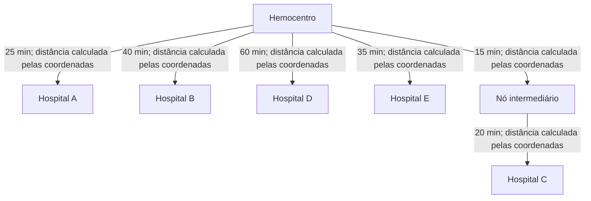

# Escopo do Grafo — HemoFlow (AED)

> Documento de definição do grafo de roteirização do projeto HemoFlow, referente à Semana 2 do cronograma. Define o tamanho, a estrutura e as regras do grafo usado no cálculo de rotas de distribuição.

---

## 1. Objetivo do Grafo

Representar a rede de distribuição entre o hemocentro e os hospitais atendidos, permitindo construir uma rota pelo **algoritmo do vizinho mais próximo**, partindo da origem do pedido e escolhendo em cada passo o vizinho não visitado com menor tempo de viagem. O algoritmo é guloso e não garante o menor tempo global nem encontrar todos os caminhos existentes.

---

## 2. Definição de Nós e Arestas

### Nós (vértices)
Cada nó representa uma unidade física da rede:
- **1 Hemocentro** — nó central, único ponto de origem das entregas.
- **5 a 6 Hospitais** — nós folha, pontos de destino das entregas.
- Cada nó pode armazenar latitude e longitude; elas são necessárias para criar ligações com distância geográfica.

### Arestas
Cada aresta representa uma via/rota entre duas unidades, com peso associado:
- **Tempo estimado** = duração da ligação, em minutos; é o peso usado para escolher localmente o vizinho mais próximo.
- **Distância** = calculada em quilômetros em linha reta a partir das coordenadas dos nós ligados, usando a fórmula de Haversine; não representa a quilometragem real da malha viária.
- As arestas são **direcionadas**, como na implementação atual: só se percorre a ligação no sentido origem → destino cadastrado. Para representar uma via de mão dupla, cadastre uma aresta em cada sentido.
- Podem existir **1 a 2 rotas intermediárias** (nós de passagem, não necessariamente hospitais) para exercitar caminhos com mais de uma aresta.

---

## 3. Tamanho do Grafo

| Item | Quantidade | Justificativa |
|---|---|---|
| Nós totais | 6 a 8 | 1 hemocentro + 5-6 hospitais + até 2 nós intermediários opcionais |
| Arestas | ~8 a 12 | Conexões diretas hemocentro-hospital, mais eventuais conexões intermediárias |

---

## 4. Algoritmo do Vizinho Mais Próximo

- **Algoritmo escolhido:** vizinho mais próximo (guloso).
- **Regra:** partindo da origem do pedido, percorre as arestas de saída e escolhe o vizinho ainda não visitado com menor tempo; repete até chegar ao destino ou ficar sem vizinhos elegíveis.
- **Desempate:** identificador do destino em ordem lexicográfica.
- **Limitação:** a escolha local não garante o menor custo total e pode deixar de encontrar o destino mesmo quando existe outro caminho. Não há retrocesso.
- **Entrada:** nó de origem (Hemocentro) e nó de destino (Hospital solicitante).
- **Saída:** sequência de nós visitados e o tempo total do percurso; se não alcançar o destino, o resultado informa que não foi encontrado.
- **Complexidade:** O(V+E) de tempo esperado e O(V) de espaço auxiliar. Cada vértice é visitado no máximo uma vez e as listas de vizinhos dos vértices visitados são examinadas uma vez; a soma dos vizinhos examinados não ultrapassa E.

---

## 5. Restrição de Cadeia Fria

- Cada Hemocomponente possui um **limite máximo de tempo de transporte** antes de comprometer a temperatura (ex.: 120 minutos).
- Após o cálculo da rota, o sistema compara o tempo total estimado com esse limite:
  - Se **dentro do limite** → rota aprovada para entrega.
  - Se **fora do limite** → sistema sinaliza o risco antes da confirmação (não bloqueia necessariamente, mas alerta).

---

## 6. Representação em Grafo (Mermaid)

Exemplo ilustrativo da estrutura (nomes fictícios, apenas para visualização do escopo):



---

## 7. Estrutura de Dados

Representação como **lista de adjacência**, adequada para grafos pequenos e esparsos como este:

```java
class Grafo {
    Map<String, List<Aresta>> adjacencias = new HashMap<>();

    void adicionarAresta(String origem, String destino, int tempoMinutos, double distanciaKm) {
        adjacencias.computeIfAbsent(origem, k -> new ArrayList<>())
                   .add(new Aresta(destino, tempoMinutos, distanciaKm));
    }
}

class Aresta {
    String destino;
    int tempoMinutos;
    double distanciaKm;

    Aresta(String destino, int tempoMinutos, double distanciaKm) {
        this.destino = destino;
        this.tempoMinutos = tempoMinutos;
        this.distanciaKm = distanciaKm;
    }
}
```

A implementação persiste as coordenadas nos nós e calcula a distância da aresta em quilômetros no momento da leitura. O endpoint de topologia informa os dois atributos da ligação e o endpoint de rota informa tempo total e distância total. A escolha do vizinho é baseada no tempo da aresta; a distância geográfica é informativa.

---
